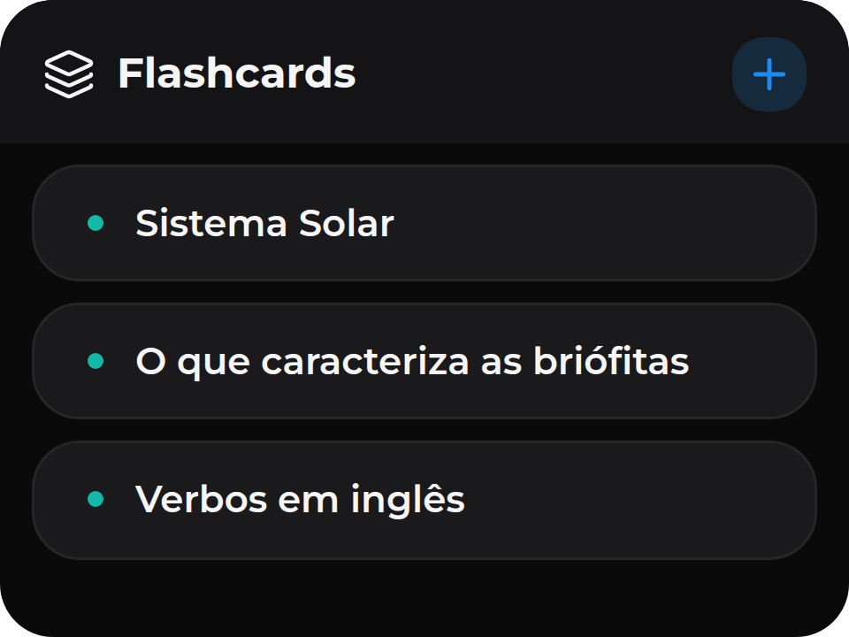
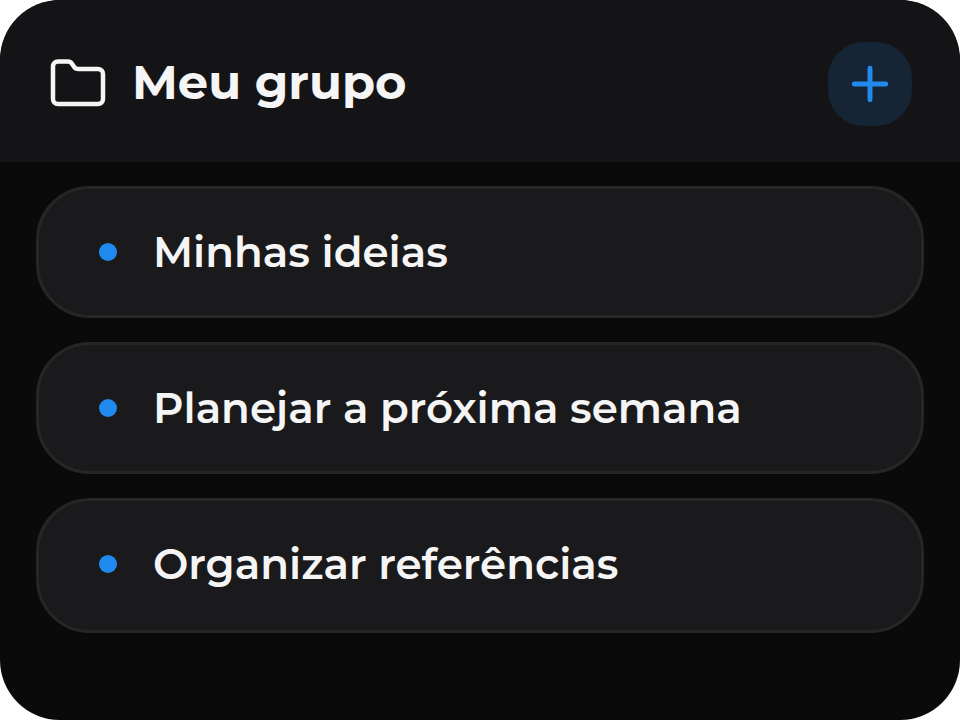
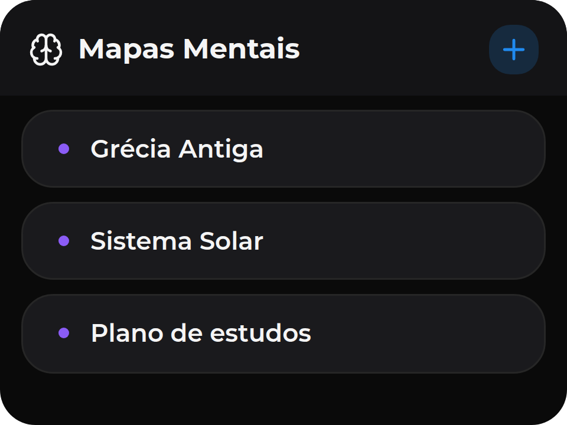
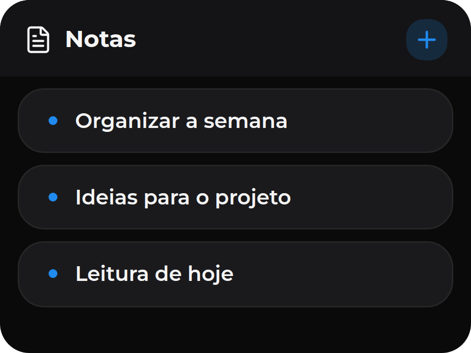
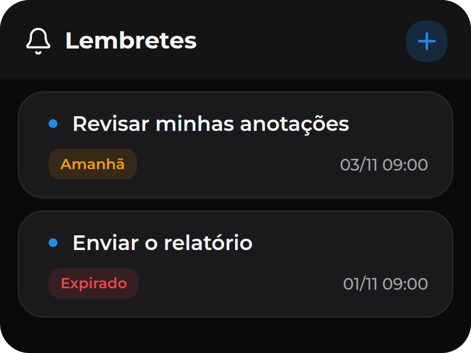

<p align="center">
  
</p>

<h1 align="center">Genly</h1>

<p align="center"><strong>Um aplicativo inteligente para organização acadêmica, financeira e pessoal.</strong></p>

<p align="center">
  
  
  
  
  
</p>

<p align="center">
  <a href="https://github.com/jefersonapps/genly/releases/latest"></a>
</p>

<p align="center"><a href="https://github.com/jefersonapps/genly/releases">Ver todas as versões e downloads</a></p>

---

## 🚀 Sobre o Projeto

O **Genly** é um aplicativo móvel voltado para produtividade, finanças e estudos. Desenvolvido em React Native, sua arquitetura é fundamentada no conceito *offline-first*, garantindo privacidade e processamento local dos dados através de SQLite. O principal foco do Genly é a integração com Inteligência Artificial (via API key) para otimizar fluxos de trabalho, como extração de textos, geração de notas, geração de mapas mentais e flashcards.

---

## ✨ Principais Funcionalidades

### 📚 Estudos e Produtividade
*   **Anotações e Tarefas:** Suporte a Markdown, equações matemáticas (LaTeX), anexos de mídia e organização flexível em grupos ou pastas.
*   **Mapas Mentais:** Telas interativas para planejamento visual. Suporta arrasto dinâmico de nós, expansão/retração de ramos, imagens inseridas e **geração contextual de mapas inteiros via IA**, com possibilidade de exportação visual.
*   **Leitor de PDF Avançado:** Ferramenta robusta para leitura e marcação de documentos, contendo caneta interativa, marca-texto, borracha e exportação final do documento renderizado.
*   **Método Pomodoro Integrado:** Temporizador animado e focado na retenção de estudos para manter o fluxo sem alternar entre aplicativos.
*   **Extração de Texto (OCR):** Reconhecimento óptico em imagens (câmera ou galeria) com pós-processamento via IA para converter mídia visual em notas estruturadas.

### 💰 Finanças Pessoais
*   **Dashboard Financeiro:** Visualização clara das receitas, despesas e saldo atual com categorização dinâmica.

### ⚙️ Sistema e Ferramentas Destaque

*   **Captura via "Share to":** O app funciona de forma persistente como alvo de compartilhamento no sistema operacional nativo para coletar imagens, PDFs e textos externos.
*   **Integração por Widgets:** Acesso instantâneo a finanças e notas recentes a partir da tela principal (Android Widgets).
*   **Autenticação Biométrica:** Módulo nativo de criptografia e proteção por impressão digital/reconhecimento facial para blindar informações seletas do banco de dados.
*   **Backup Offline Completo:** Compressão, exportação e importação de todo o banco relacional e da base de mídia pesada (imagens e documentos) em formato ZIP, garantindo a interoperabilidade entre dispositivos.
*   **Recursos Acessórios:** Temas Claro/Escuro personalizáveis por *Accent Colors* e um Scanner Rápido Multiuso para leitura de QR Codes e Barcodes de infraestrutura.

---

## 📱 Screenshots

### Home
<div align="center">

</div>

### Widgets
<div align="center">

  
  
  
  
  
</div>

---

## Atualizar as imagens dos widgets

As prévias são geradas a partir dos componentes de `src/widgets`, com dados de
exemplo, ícones SVG e as fontes Montserrat do app. Não é necessário capturar ou
recortar screenshots no celular. Com Chrome ou Chromium instalado, execute:

```bash
npm run widgets:previews
```

O comando atualiza os cinco PNGs em `assets/widget-preview/` e, se a pasta Android
já existir, sincroniza também as imagens nativas usadas pelo Gradle. Execute-o
após alterar o layout dos widgets e inclua os PNGs atualizados no commit. Os
aparelhos recebem as novas imagens no próximo APK; o launcher pode manter uma
prévia em cache até atualizar seu seletor de widgets.

Veja os detalhes em [Geração das prévias dos widgets](./docs/widget-previews.md).

---

## 🛠️ Ciclo de Release e Atualizações (In-App Updates)

O Genly implementa um serviço em segundo plano focado no escrutínio das **[Releases Públicas do Repositório](https://github.com/jefersonapps/genly/releases/)**. Em vez de depender das grandes lojas de aplicativos, o próprio app notifica o usuário sobre a disponibilidade de uma nova versão e media o processo de instalação nativa de forma amigável.

Para realizar o deploy e acionar a distribuição da versão para todos os clientes ativos, é estritamente necessário seguir os passos de versionamento abaixo.

### 1. Atualizar as Definições Locais
As flags de versão precisam ser modificadas primeiramente no código-fonte para refletir a numeração futura.

No arquivo `app.json`:
- `"version": "1.1.0"`: Versão atual do aplicativo. **Este valor exato deve ser o nome da tag (release target) do GitHub**.
- `"versionCode": 11`: Código atual do build Android. Incremente a cada nova distribuição para permitir a atualização das instalações existentes.

No arquivo `package.json`:
- `"version": "1.1.0"`: Mantenha sincronizado com a versão do `app.json`.

### 2. Efetuar o Build de Distribuição
Compile o novo *bundle* para ambiente de produção (Release). 

Execute a partir da raiz do projeto para gerar um único APK para dispositivos ARM:

```bash
cd android
./gradlew assembleRelease -PreactNativeArchitectures=armeabi-v7a,arm64-v8a
```

Os comandos são executados dentro de `android`; use `./gradlew` com a barra. Se a pasta nativa não existir, gere-a com `npx expo prebuild --platform android` a partir da raiz. Quando `android` já existe, confira se `android/app/build.gradle` contém a mesma versão e `versionCode` do `app.json`, pois a pasta gerada não é versionada.
> O artefato (APK) de saída será injetado no diretório absoluto: `android/app/build/outputs/apk/release/app-release.apk`
> *Nota: Garantir assinatura de builds em produção usando a keystore JKS correta nas variáveis de ambiente.*

`assembleRelease` gera um APK de release; a configuração atual não usa splits por
arquitetura, portanto o arquivo reúne as arquiteturas configuradas em um único APK.
Não use `bundleRelease`, que gera um AAB.

**Assinatura:** o template Android gerado usa `signingConfigs.debug` também no
build `release`. Confira a configuração antes de publicar. Para atualizar instalações
existentes, o APK precisa ter o mesmo pacote (`com.genly.app`) e a mesma chave de
assinatura do APK anteriormente distribuído. Não gere ou troque a chave durante
esta atualização; preserve a keystore usada na versão publicada.

### 3. Publicar o Artefato (GitHub Releases)
- Acesse e crie um novo **Draft** na aba de *Releases* deste repositório no GitHub.
- Insira em **Tag version** rigorosamente o mesmo valor adicionado na diretriz `version` configurada passo 1.
- Especifique as adições, correções de bugs, e manutenções feitas ao longo do log como título e descrição principal do formulário (nota: O Genly **extrairá nativamente esta string interativamente via API sob demanda** para exibir ao usuário dentro do aplicativo na notificação modal de novas Notas de Atualização).
- Realize o upload inserindo o binário compilado (`app-release.apk`) no bloco de assets.
- Confirme a submissão marcando a opção **Publish Release**.

Publique como uma release pública estável, com **Set as latest release** marcado
e **This is a pre-release** desmarcado. Anexe apenas o APK de produção
`app-release.apk` antes de publicar. O atualizador consulta `/releases/latest`,
compara a tag com a versão instalada e usa o primeiro asset cujo nome termina em `.apk`.
O aviso chega na próxima verificação de atualização do app; não é uma notificação push.

A partir deste registro público, qualquer instância pré-instalada consumirá as informações atualizadas pelas rotas e engatilhará as diretrizes internas assíncronas de download e substituição do serviço nativo.

---

## 💻 Stack Tecnológico

Consulte o [guia de atualização para o Expo SDK 58](./docs/expo-58-upgrade.md)
para instalar as dependências, regenerar os projetos nativos e verificar a
compatibilidade do APK com páginas de memória de 16 KB.

- **Frontend e Views:** React Native (Expo SDK 58) | Expo Router
- **Data Layer:** SQLite Nativo | Drizzle ORM
- **State Management:** Zustand
- **Graphics e Animações:** React Native Skia | React Native Reanimated
- **Integração de SO:** React Native Blob Util | Document Scanner | Android Custom Widgets
- **Styling:** Tailwind CSS integrado (NativeWind)

---

